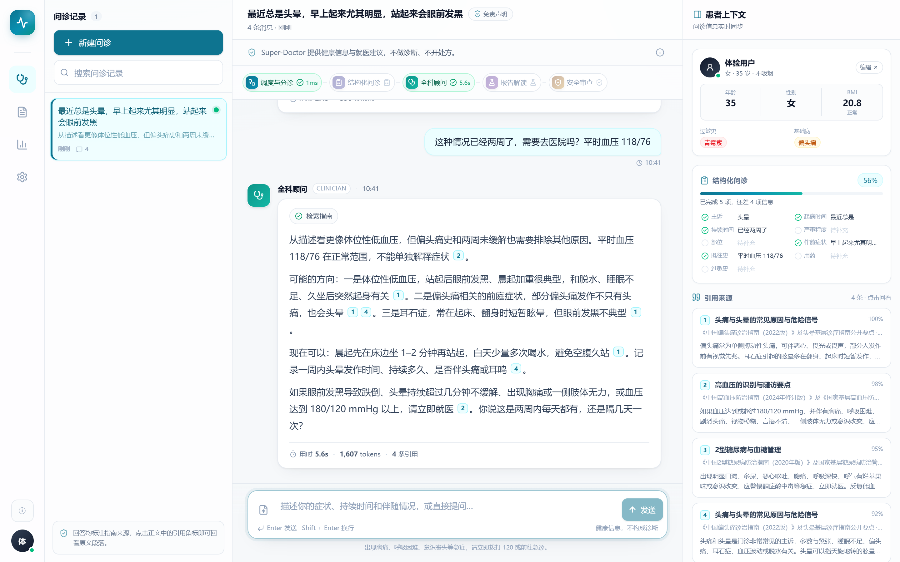
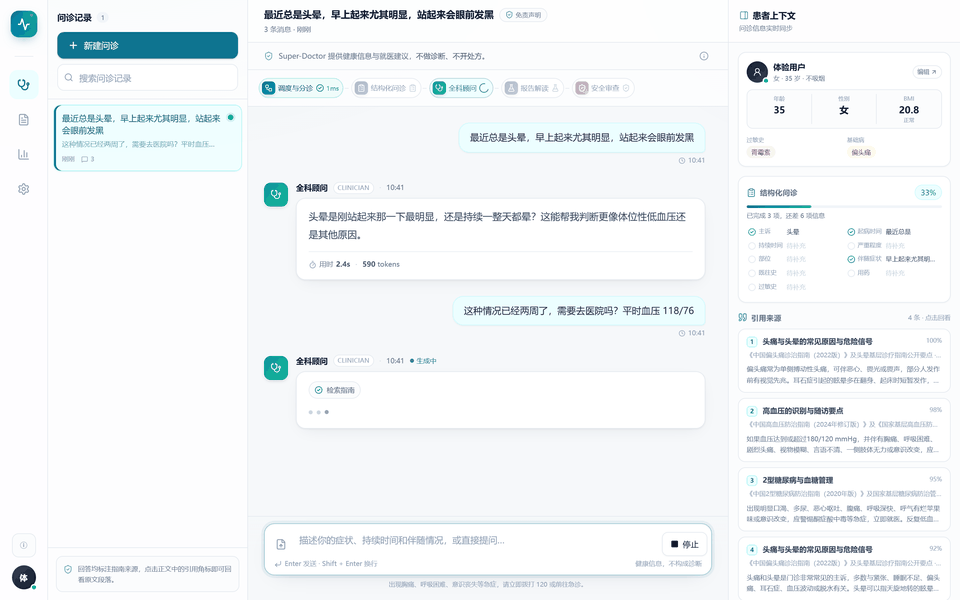
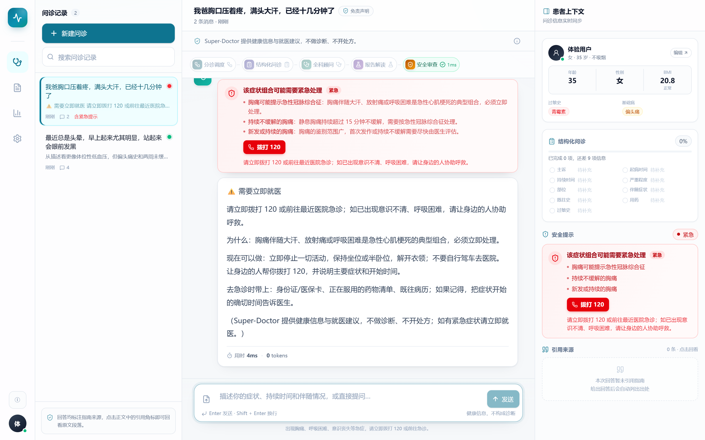
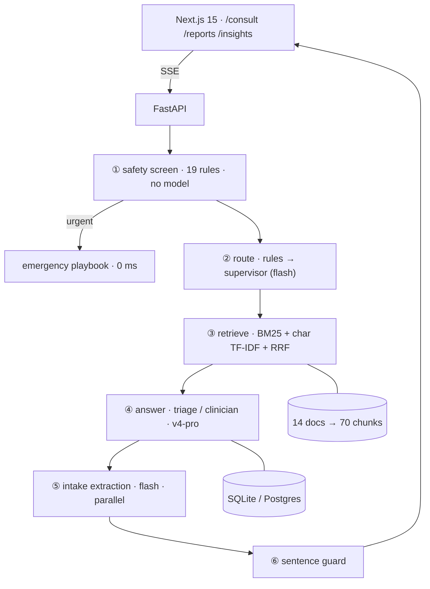
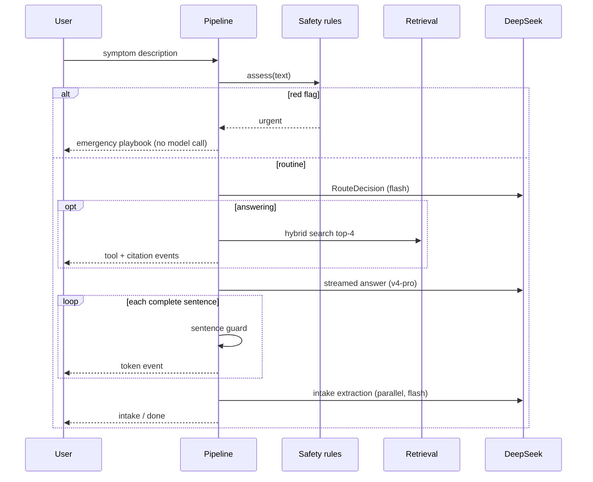

# Super-Doctor · A triage-first medical consultation agent system

> Turn "I don't feel well" into a structured history, triage it, answer with citations — and never spend a second of model time on a possible heart attack.

<p align="center">
  
</p>

<p align="center">
  
</p>

<p align="center">
<p align="center">
  <a href="https://github.com/drunksu/super-doctor"></a>
  
  
  
  
</p>

## Why "Super-Doctor"

The name points at the [Super-agent](https://github.com/deepseek-ai/dsh-superagent-prototype)
design DeepSeek Harness published on 2026-10-31: a resident router that owns human
interaction, isolated workers running in parallel, and events that skip the queue when they
matter. In a medical setting the thing that must never queue is an emergency — so the red-flag
path here never touches a model at all.

| Super-agent property | Where it lands in Super-Doctor |
| --- | --- |
| **Continuous** — one agent across channels | one session spans follow-up, advice and review; slots and profile accumulate across turns |
| **Efficient** — parallel, non-blocking | intake extraction runs alongside answer generation; the reply streams sentence by sentence |
| **Proactive** — acts when it should, quiet otherwise | a red flag answers immediately without a model; thin signals get one question, not a lecture |
| **Persistent** — recovers from failure | empty retrieval degrades with an `ungrounded_answer` flag; supervisor timeout falls back to a heuristic; bad PDFs return an actionable error |

The prototype is a coding agent for GitHub/Feishu; this project keeps its **router + isolated
workers + event triage** structure and drops the channel and authorization model.

## What this is

A working consultation system, not a chatbot with a doctor persona. A user describes a
symptom; the system screens for red flags with deterministic rules, decides whether to ask
a follow-up or answer, retrieves guideline chunks *before* generating, and releases the
answer one sentence at a time through an output guard.

| Decision | Implementation |
| --- | --- |
| **Safety is a gate, not a prompt** | 19 regex rules run first; a hit returns an emergency playbook with **zero model calls** |
| **Retrieve before you generate** | Clinical claims can only cite chunks retrieved in this turn; fabricated markers are stripped |
| **Stream prose, type the state** | User-facing text streams; slots, severity and citations come from separate structured calls |
| **Sentence-level guard** | Prescriptions and definitive diagnoses are replaced *before* they reach the browser, not after |

<p align="center">
  
</p>

## Architecture



A turn, end to end:



### Roles

| Role | Model | Job | Contract |
| --- | --- | --- | --- |
| Safety | none (rules) | red flags, emergency routing | `SafetyAssessment` |
| Supervisor | `deepseek-flash` | follow-up / answer / small talk | `RouteDecision` |
| Triage | `deepseek-v4-pro` | exactly one question | streamed text |
| Clinician | `deepseek-v4-pro` | grounded advice + care thresholds | streamed text |
| Intake | `deepseek-flash` | free text → structured slots | `IntakeExtraction` |
| Report | `deepseek-v4-pro` | lab values → plain language | `ReportNarrative` |

## Evaluation

Two tracks, because two different questions are being asked ([method](docs/evaluation.md)).
Track A forces Super-Doctor onto the `advise` route and gives both systems the same retrieved
chunks, so only answer quality is compared. Track B measures behaviour the baseline simply
does not have.

| Track A · answer quality (18 cases) | Super-Doctor | Single-agent baseline |
| --- | --- | --- |
| LLM-as-judge mean (0–5) | 4.06 | 4.44 |
| Judge pass rate (≥4) | 0.83 | 0.94 |
| Valid citation rate | 1.00 | 1.00 |
| Forbidden phrasing hits | 0 | 0 |
| Average latency | 5.86 s | 4.31 s |
| Average output tokens | 222 | 144 |

| Track B · behaviour | Result |
| --- | --- |
| Emergency routing accuracy (6 cases) | **100%** |
| First answer on an emergency | **0 ms** (template, no model) |
| First-turn follow-up rate | **100%** |
| One-question compliance | 75% |
| Slots captured after one turn | 32% |
| Advice requests routed to the clinician | **100%** |

**Reading the table.** The baseline is ~0.4 ahead on judge mean, and the same pipeline scored
4.06 / 4.11 / 4.22 across three consecutive runs (baseline steady at 4.44), so the real gap
is 0.2–0.4 — not a capability difference. What the architecture buys is elsewhere: a
0-latency emergency path that never touches a model, 100% follow-up on thin information,
verifiable citation numbers, and an output guard. Latency moved from 3.9 s to 5.9 s between
runs, which tracks model API variance rather than a code change.

> 32 synthetic cases, one run, self-authored rubrics. This measures system behaviour, not
> medical validity.

## Stack

| Layer | Choice | Why |
| --- | --- | --- |
| Orchestration | **PydanticAI 2.x** + an explicit pipeline | typed outputs, DI, testable; the state machine is hand-written so streaming semantics are fully controlled |
| Models | DeepSeek `v4-pro` (writer) / `flash` (router) | native reasoning, tool calling, OpenAI-compatible |
| Retrieval | BM25 + char n-gram TF-IDF + RRF | on 70 Chinese chunks a character-space model beats a small dense model on terms like 低密度脂蛋白 — and needs no weights |
| API | FastAPI + SQLAlchemy 2.0 async | one command to run; Postgres is a `DATABASE_URL` away |
| Streaming | SSE | simpler than WebSocket, proxy-friendly, resumable |
| Web | Next.js 15 + React 19 + Tailwind v4 | App Router, no UI library |
| Tests | pytest + httpx ASGITransport | 62 cases: rules, retrieval, guard, SSE protocol, report parsing |

## Quick start

```bash
python -m venv .venv
.venv/Scripts/pip install -e "backend[dev]"     # Windows
# .venv/bin/pip install -e "backend[dev]"       # macOS / Linux
cp backend/.env.example backend/.env            # add DEEPSEEK_API_KEY
.venv/Scripts/python -m uvicorn app.main:app --port 8000 --app-dir backend

cd frontend && pnpm install && pnpm dev         # http://localhost:3000
```

Sign in with `demo@superdoctor.ai` / `demo1234`. No API key? `MODEL_MODE=auto` falls back to a
scripted offline demo and `/api/health` reports `model_mode: mock` — it never pretends to be
a model.

One-liner scripts: `pwsh -File scripts/dev.ps1` or `./scripts/dev.sh`. Docker:
`docker compose up --build`.

## Safety model

1. **Gate** — 19 rules, negation-aware, severity can only escalate. `urgent` never reaches a model.
2. **Grounding** — claims must come from this turn's chunks; out-of-range citation markers are deleted.
3. **Sentence guard** — "drug + dose", definitive diagnoses and dose adjustments are replaced before sending.

The boundary is enforced in code and tested, not just disclaimed in the UI.

## Known limits

- No diagnosis, no prescription, no medical imaging (there is no OCR pipeline; the UI says so).
- 32 evaluation cases with self-authored rubrics — behaviour, not medicine.
- Single-tenant (`user_id` scoping); a real deployment needs row-level security.
- Sparse retrieval: swap in an embedding service beyond a few hundred documents (an `EmbeddingProvider` seam exists).
- `docker-compose.yml` was not exercised locally (no Docker on the author's machine); the direct path is verified.

## Docs

- [Architecture & trade-offs](docs/architecture.md)
- [Evaluation method](docs/evaluation.md)
- [API contract](docs/api-contract.md)
- [Demo script](docs/demo.md)
- [中文 README](README.md)

---

MIT License · A demonstration project providing health information and care guidance; it is
not a diagnosis or a prescription. In an emergency, call your local emergency number.
