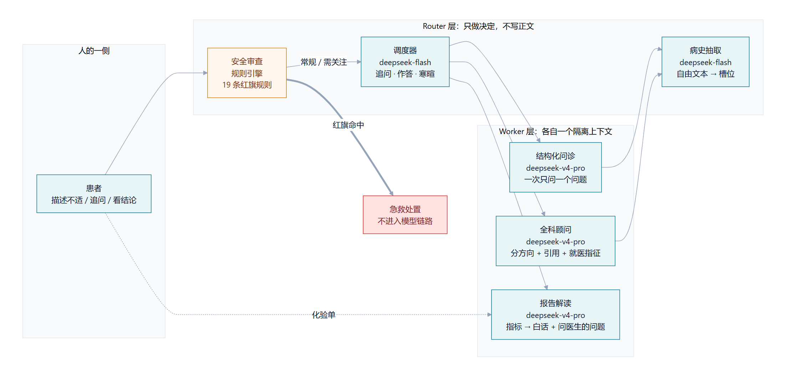
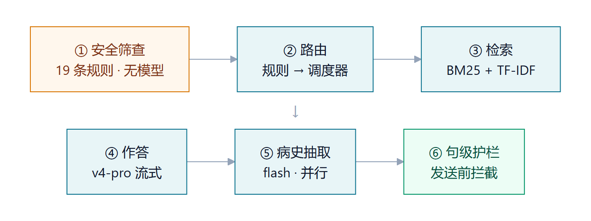
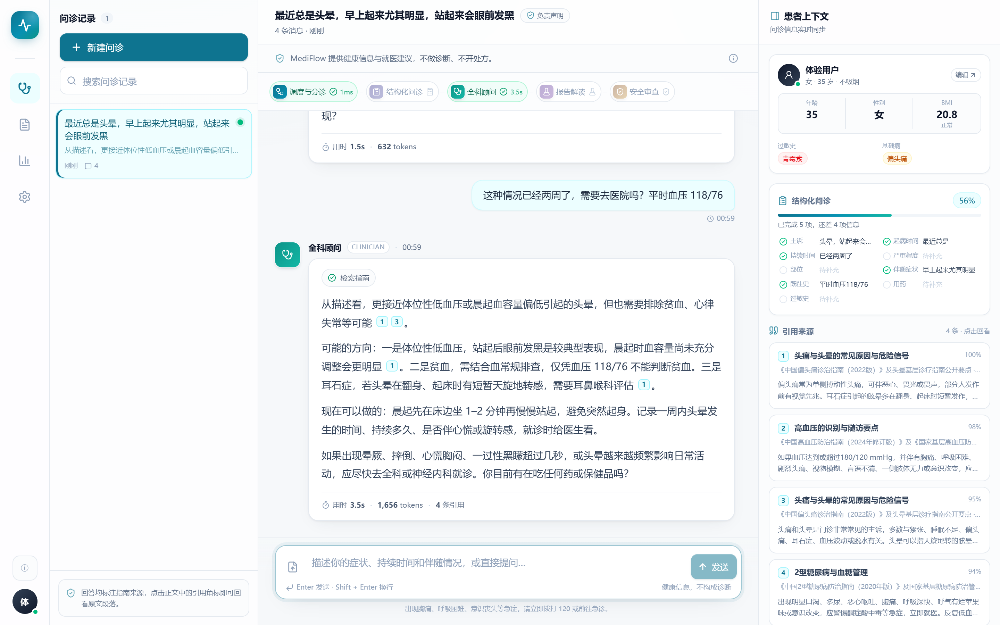
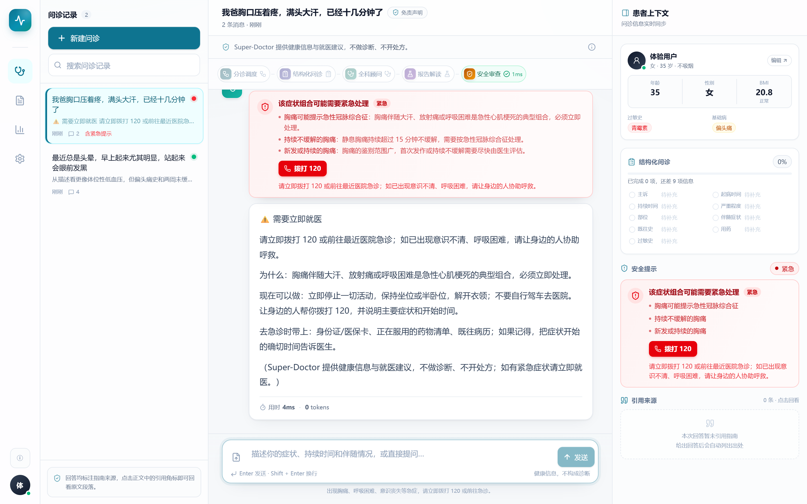
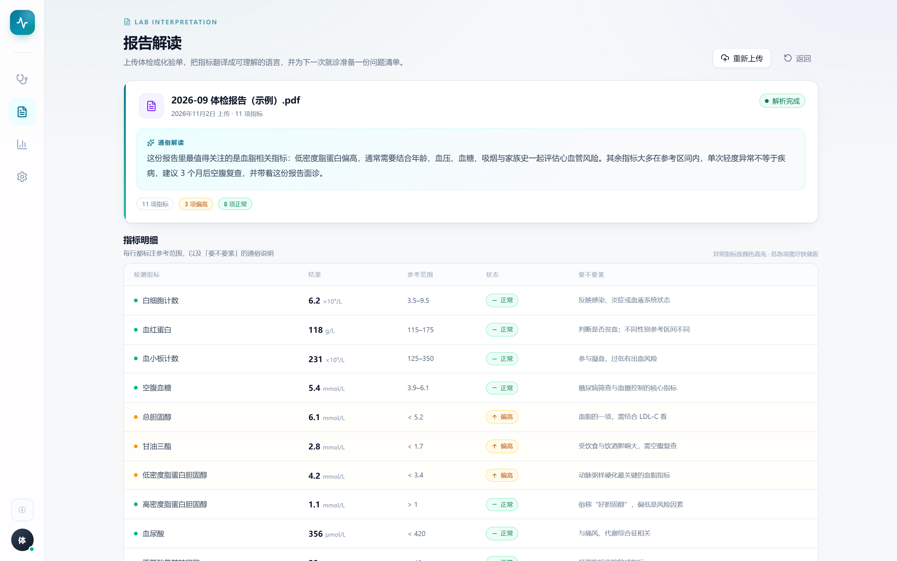
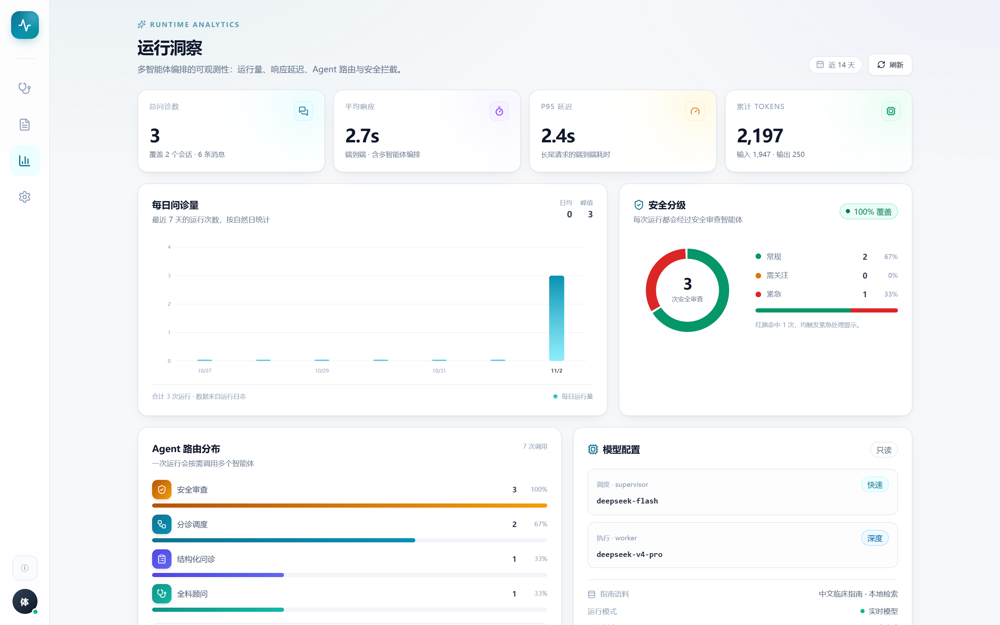
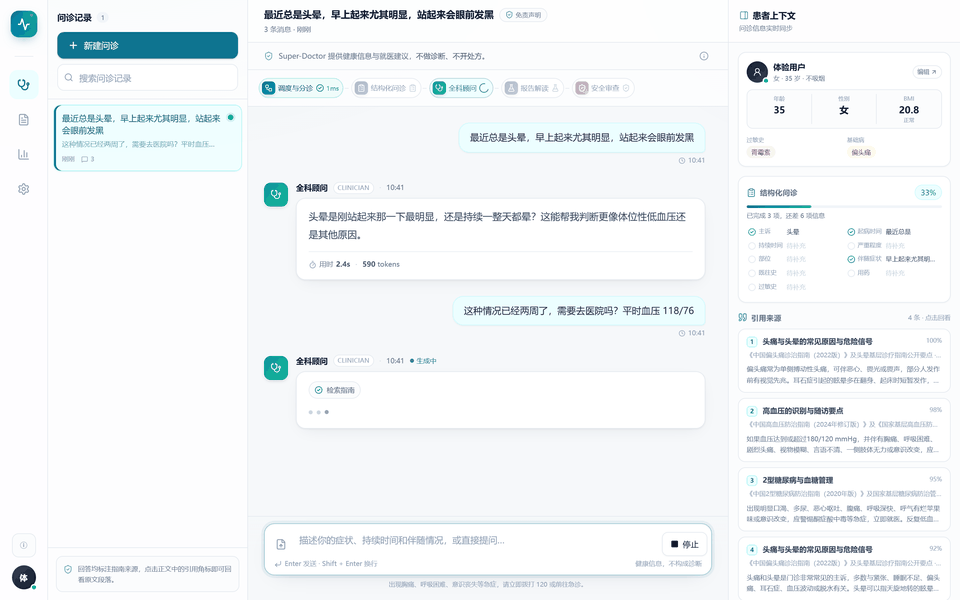
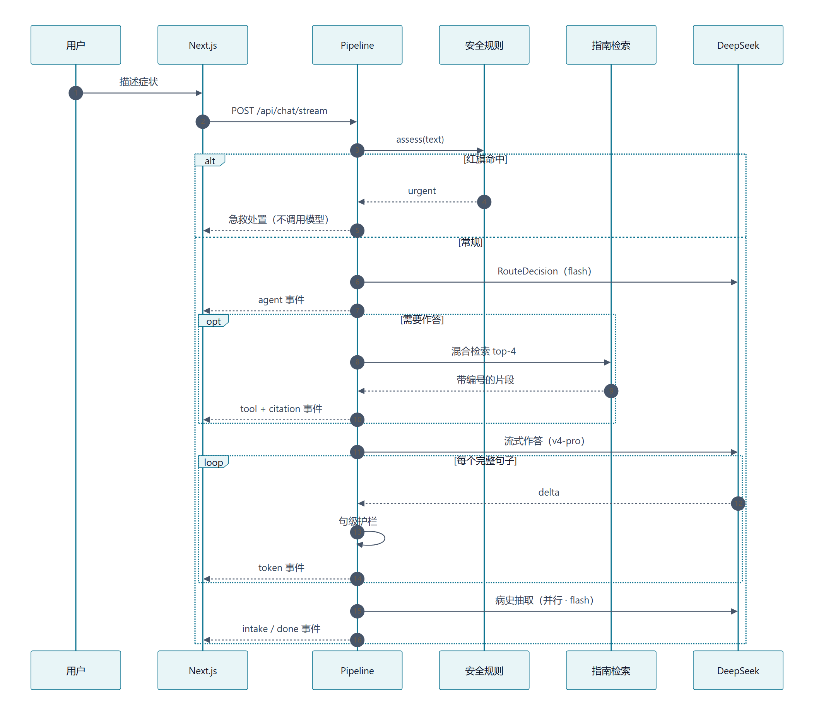

<p align="center">
  
</p>

<div align="center">

<a href="https://github.com/drunksu/super-doctor/stargazers"></a>
<a href="https://github.com/drunksu/super-doctor/actions/workflows/ci.yml"></a>


<a href="LICENSE"></a>
<a href="#安装与运行"></a>

</div>

<div align="center">

🚀 [框架](#框架) · ⚡ [安装](#安装与运行) · 🎬 [界面](#界面) · 🧠 [Python 用法](#python-用法) · 📊 [评测](#评测) · 🤝 [Contributing](#contributing) · 📄 [Citation](#citation)

</div>

---

# Super-Doctor：分诊优先的智能问诊多智能体系统

患者说「我不舒服」，系统把它拆成结构化病史，先做分诊，再给出**有出处**的建议；如果描述里出现红旗症状，则在模型介入之前就转成急救处置。

> 本项目只提供健康信息与就医指引，不做诊断、不开处方，也不解释医学影像。它不是医疗器械，不能替代面诊；紧急情况请立即拨打 120。完整条款见 [DISCLAIMER.md](docs/DISCLAIMER.md)。

## 3 分钟看懂

| 时间 | 你会看到什么 | 去哪看 |
| --- | --- | --- |
| 30 秒 | 它是什么：一句话 + 两张架构图（Router 分工、六阶段） | 上方简介 · [框架](#框架) |
| 1 分钟 | 判断力在哪：红旗规则先于任何模型调用；Router 只做决定、Worker 隔离上下文；护栏逐句放行 | [框架](#框架) |
| 2 分钟 | 凭什么信：62 个 pytest 用例、评测方法与三轮波动表、已知限制与降级策略，短板摊开写 | [评测](#评测) |
| 3 分钟 | 自己跑：**不需要 API key**，后端无 key 自动进 demo 模式，前端用 `demo@superdoctor.ai` 登录；或者只看 CI 是不是绿的 | [安装与运行](#安装与运行) |

## 更新日志

- **v0.2.0**（2026-11）— 更名 Super-Doctor，README 按「框架 → 安装 → 用法 → 评测 → 可复现性」重组；新增渲染版架构图、CI 校验与三轮评测波动表。
- **v0.1.0**（2026-11）— 首个公开版本：六阶段问诊流水线、三层记忆、指南检索、SSE 流式、报告解读、62 个测试。

<details>
<summary>完整变更记录</summary>

见 [CHANGELOG.md](CHANGELOG.md)。

</details>

---

## 框架

Super-Doctor 把一轮问诊拆成**一个确定性闸门 + 两层 Agent**。Router 层只做决定（该追问、该作答、该报警），不写正文；Worker 层各自拥有隔离的上下文，只负责自己那一段话。

<p align="center">
  
</p>

<p align="center">
  
</p>

### 人的一侧

- **患者**：用自然语言描述不适、补充细节、上传或粘贴化验单。系统不要求他先学会怎么描述症状。

### Router 层（只做决定）

- **安全审查**：19 条确定性规则 + 否定词窗口，跑在任何模型调用之前。命中红旗时，本轮**不产生任何模型调用**。
- **调度器**（`deepseek-flash`）：判断这一轮该追问、该作答还是寒暄。多数轮次由规则快路径决定，调度模型只做兜底。
- **病史抽取**（`deepseek-flash`）：在回答生成的同时，把自由文本变成 9 个结构化槽位，不阻塞首字。

### Worker 层（各自一个隔离上下文）

- **结构化问诊**（`deepseek-v4-pro`）：一次只问一个最关键的缺口问题，并说明为什么问。
- **全科顾问**（`deepseek-v4-pro`）：分方向作答（可能的方向 / 现在可以做 / 什么情况必须就医），每条结论挂引用编号。
- **报告解读**（`deepseek-v4-pro`）：把化验值翻译成白话，标出偏离程度，生成「可以问医生的问题」。

### 为什么叫 Super-Doctor

命名致敬 DeepSeek Harness 团队 2026 年 10 月 31 日提出的 [Super-agent](https://github.com/deepseek-ai/dsh-superagent-prototype)：常驻 Router 收口人类交互、隔离 Worker 并发干活、重要事件不排队。放到医疗场景，最不该排队的是**急诊**。

| Super-agent 的四条特征 | 在这里的落点 |
| --- | --- |
| **连续**：跨渠道是同一个 Agent | 一个会话贯穿追问、建议、复查；槽位与长期档案跨轮累积 |
| **高效**：并行、不阻塞 | 病史抽取与回答生成并行；逐句流式下发 |
| **主动**：该说话才说 | 红旗命中直接给急救处置，不等指令；信息不足时只问一个问题 |
| **持久**：异常可恢复 | 检索为空降级并标记、调度超时按完整度兜底、解析失败给可操作提示 |

与参考实现的差异也写在明面上：Super-agent 原型是面向 GitHub / 飞书的 coding agent，本项目复用的是 **Router 收口 + Worker 隔离 + 事件分级** 的结构，而不是它的渠道与授权模型。

> 设计取舍、失败模式与数据模型见 [docs/architecture.md](docs/architecture.md)。

---

## 安装与运行

需要 Python 3.12、Node 22、pnpm 9+。没有 Docker 也能完整运行。

### 本地

```bash
git clone https://github.com/drunksu/super-doctor.git
cd super-doctor

python -m venv .venv
.venv/Scripts/pip install -e "backend[dev]"        # Windows
# .venv/bin/pip install -e "backend[dev]"          # macOS / Linux

cp backend/.env.example backend/.env               # 填入 DEEPSEEK_API_KEY
.venv/Scripts/python -m uvicorn app.main:app --port 8000 --app-dir backend
```

另开一个终端：

```bash
cd frontend
pnpm install
pnpm dev
```

打开 <http://localhost:3000>，用 `demo@superdoctor.ai` / `demo1234` 登录。API 文档在 <http://127.0.0.1:8000/docs>。

一条命令启动两端：`pwsh -File scripts/dev.ps1`（Windows）或 `./scripts/dev.sh`（macOS / Linux）。

### Docker

```bash
cp .env.example .env          # 可留空，留空则跑离线演示模式
docker compose up --build     # web :3000 · api :8000
```

> `docker-compose.yml` 在当前开发机上没有 Docker 环境，未经端到端验证；本地直跑路径是验证过的。

### 环境变量

| 变量 | 默认值 | 说明 |
| --- | --- | --- |
| `MODEL_MODE` | `auto` | 有 Key 走真实模型、无 Key 走离线演示；也可强制 `live` / `mock` |
| `DEEPSEEK_API_KEY` | — | 必填（离线演示模式除外） |
| `MODEL_SUPERVISOR` | `deepseek-flash` | 路由与抽取用的快模型 |
| `MODEL_WORKER` | `deepseek-v4-pro` | 问诊、建议、报告解读用的强模型 |
| `JWT_SECRET` | 开发默认值 | 生产必须替换 |
| `DATABASE_URL` | SQLite | 换成 `postgresql+asyncpg://…` 即切 Postgres |
| `MAX_UPLOAD_MB` | `10` | 报告上传大小上限 |

**没有 API Key 也能跑**：`MODEL_MODE=auto` 会自动进入离线演示模式（脚本化对话、同样的 SSE 协议），`/api/health` 会如实返回 `model_mode: mock`——演的不是模型，是产品。

---

## 界面

<p align="center">
  
</p>

一次带引用的回答：上方是 Agent 时间线（每个环节的真实耗时），回答里的编号对应右侧的指南原文。

<p align="center">
  
</p>

红旗命中：红色横幅 + 一键拨打 120，回答不经过模型，耗时 0 ms。

<table>
  <tr>
    <td width="50%"></td>
    <td width="50%"></td>
  </tr>
  <tr>
    <td align="center"><sub>报告解读：逐项对照参考范围</sub></td>
    <td align="center"><sub>运行洞察：路由分布、延迟、安全分级</sub></td>
  </tr>
</table>

<p align="center">
  
</p>

---

## 一轮问诊怎么跑

<p align="center">
  
</p>

前端只消费一种协议：`text/event-stream`，8 种事件。

| 事件 | 载荷 | 用途 |
| --- | --- | --- |
| `run_started` | `run_id` / `trace_id` | 一次问诊的开始 |
| `agent` | `agent` / `status` / `ms` | 驱动 Agent 时间线 |
| `token` | `text` | 流式正文 |
| `tool` | `name` / `status` / `preview` | 检索过程的可见性 |
| `citation` | `id` / `source` / `snippet` / `score` | 引用卡片 |
| `intake` | 9 个槽位 + `completeness` | 结构化问诊进度 |
| `safety` | `level` / `flags` / `action` | 红黄绿分级与急救动作 |
| `done` | `message_id` / `latency_ms` / `usage` | 收尾与统计 |

完整契约见 [docs/api-contract.md](docs/api-contract.md)。

---

## Python 用法

流水线是一个普通的异步生成器，可以脱离 HTTP 直接驱动（在 `backend/` 目录下运行，需要 `.env`）：

```python
import asyncio
from app.agents.pipeline import TurnContext, TurnResult, stream_turn

async def main() -> None:
    ctx = TurnContext(user_text="最近总是头晕，早上起来更明显")
    result = TurnResult()
    async for event, data in stream_turn(ctx, result):
        if event == "token":
            print(data["text"], end="", flush=True)
    print("\n引用:", [c["id"] for c in result.citations])

asyncio.run(main())
```

评测脚本同样可以直接调用，跑「多智能体 vs 单智能体」双轨对比：

```bash
cd backend
python -m app.evals.runner --limit 8          # 冒烟
python -m app.evals.runner                    # 全量，写入 app/evals/results/
```

---

## 记忆与恢复

| 层 | 作用域 | 存储 | 生命周期 | 注入方式 |
| --- | --- | --- | --- | --- |
| 消息窗口 | 会话 | `messages` | 30 天 TTL | 最近 12 轮 |
| 滚动摘要 | 会话 | `sessions.summary` | 随会话 | 每 6 条消息重生成 |
| 结构化档案 | 用户 | `patient_profiles` | 永久 | 每轮都注入 |
| 语义记忆 | 用户 | `memories` | 永久，按使用衰减 | 相似度 top-4 |

结构化档案永远不会被摘要——过敏史不能被「压缩」。语义记忆用来记住「去年做过胆囊手术」这类写不进固定 schema、但下次问诊需要知道的事。

降级策略是设计的一部分：

| 失败 | 行为 |
| --- | --- |
| 调度器超时 | 按信息完整度兜底，`route.source = "fallback"` |
| 检索无命中 | 照常作答，但带 `ungrounded_answer` 标记 |
| 病史抽取失败 | 本轮照常结束，槽位不推进 |
| PDF 无法解析 | 返回可操作提示，而不是 500 |
| 模型不可用 | 切换离线演示，`/health` 如实报告 |

---

## 评测

两个轨道，因为要回答两个不同的问题（方法与局限见 [docs/evaluation.md](docs/evaluation.md)）。

**A · 答案质量**：18 个「应当直接作答」的案例，两套系统拿到**同一批检索片段**、同一模型、同样要求，一次性作答；由 `deepseek-flash` 按 rubric 盲评。

| 指标 | Super-Doctor | 单智能体基线 |
| --- | --- | --- |
| LLM-as-judge 均分（0–5） | 4.06 | 4.44 |
| 通过率（≥4） | 0.83 | 0.94 |
| 有效引用率 | 1.00 | 1.00 |
| 禁用表达命中 | 0 | 0 |
| 平均延迟 | 5.86 s | 4.31 s |
| 平均输出 token | 222 | 144 |

**B · 系统行为**（单智能体没有对应机制）：

| 指标 | 结果 |
| --- | --- |
| 急诊分流准确率（6 例急症） | 100% |
| 急症首次回答延迟 | 0 ms（模板，无模型） |
| 首轮追问率（8 例信息不足） | 100% |
| 单问题合规率 | 75% |
| 首轮问诊槽位填充率 | 32% |
| 可作答问题直接给建议的比例 | 100% |

**连续三轮的波动**（同一套代码）：4.06 / 4.11 / 4.22，基线稳定在 4.44。差距 0.2–0.4，属于小样本噪声，不是能力差距。Super-Doctor 换来的是急诊 0 延迟、100% 追问、引用可校验与句级护栏。

---

## 可复现性

Super-Doctor 由大模型驱动，两次运行不会逐字相同——这是研究型系统的常态，不是缺陷。差异来自三处，值得分开看：

- **采样**：即使固定温度，服务端也不保证逐字节一致；推理模型波动最大。
- **模型版本**：`MODEL_SUPERVISOR` / `MODEL_WORKER` 指向的模型会随供应商更新而变化。想固定，就在 `.env` 里写明确的模型 ID。
- **评测 judge**：评分也是模型，与生成模型同源，存在自偏好。`docs/evaluation.md` 里给了三轮的实测波动。

能固定的部分已经固定：检索是确定性的（BM25 + TF-IDF + RRF，语料在仓库里），安全分级是确定性的（规则），引用编号在服务端校验。**评测数字应当连同模型版本和日期一起读。**

---

## 安全边界

产品的边界写在三个地方，而不只是免责声明里：

1. **前置闸门**（[`backend/app/safety/rules.py`](backend/app/safety/rules.py)）：19 条规则、否定词窗口、只能升不能降。命中 `urgent` 时本轮不产生任何模型调用。
2. **检索约束**（[`backend/app/agents/pipeline.py`](backend/app/agents/pipeline.py)）：结论必须来自本轮检索片段；越界的引用编号会被删除；一条都没检索到时，回答会带 `ungrounded_answer` 标记。
3. **句级护栏**（[`backend/app/agents/guard.py`](backend/app/agents/guard.py)）：命中「药名 + 剂量」「确诊式表达」「剂量调整」的句子，在发送前被替换——不是事后过滤，因为事后过滤时字已经在用户屏幕上了。

62 个回归用例里有一整组是「模型试图越界」的对抗文本。

---

## 技术栈

| 层 | 选择 | 为什么 |
| --- | --- | --- |
| 编排 | **PydanticAI 2.x** + 自研流水线 | 类型化输出、依赖注入；流水线是显式状态机，流式语义完全可控 |
| 模型 | DeepSeek `v4-pro` / `flash` | 原生思维链、工具调用、OpenAI 兼容 |
| 检索 | BM25 + 字符 n-gram TF-IDF + RRF | 70 个中文片段上，字符空间模型对术语更稳，零下载、零 GPU |
| 后端 | FastAPI + SQLAlchemy 2.0 async | 一条命令起；换 Postgres 只改 `DATABASE_URL` |
| 流式 | SSE（`sse-starlette`） | 比 WebSocket 简单，天然支持代理与重连 |
| 前端 | Next.js 15 + React 19 + Tailwind v4 | App Router、原生流式、零 UI 库 |
| 认证 | JWT（HS256）+ bcrypt | 无状态、易演示 |
| 测试 | pytest + httpx ASGITransport | 62 个用例，覆盖规则、检索、护栏、SSE、报告解析 |

---

## 目录结构

```
backend/
  app/
    agents/       流水线、提示词、护栏、模型工厂、离线演示
    safety/       19 条红旗症状规则
    rag/          语料加载、混合检索、引用
    memory/       消息窗口、摘要、长期档案与语义记忆
    api/          路由与 SSE
    evals/        评测集与双轨评测脚本
    services/     会话编排、报告解析、认证
  tests/          62 个用例
frontend/
  app/            /consult /reports /insights /login
  components/     23 个组件（时间线、引用卡、安全横幅、指标表…）
docs/             架构、评测方法、API 契约、演示脚本
tools/            截图 / GIF / 图表渲染脚本
```

---

## 已知限制

- **不做诊断、不开处方**，也不解释医学影像（需要单独的 OCR / 影像模型，本项目选择如实说不支持）。
- **评测样本 32 例**，rubric 自建，只能衡量系统行为，不能证明医学有效性。
- **单租户**：`user_id` 隔离足够演示，真实部署需要行级安全与字段级加密。
- **检索是稀疏模型**：语料扩到几百篇以上时应换成真正的 embedding 服务，接口已预留 `EmbeddingProvider`。
- Docker Compose 在本机没有 Docker 环境，未做过端到端验证（本地直跑路径是验证过的）。

---

## Contributing

欢迎 issue 与 PR。最小的、对项目最有价值的贡献是**加一份指南文档**——检索质量的上限由语料决定：

1. 在 `backend/app/rag/corpus/` 新建 `.md`，带 front-matter（`id` / `title` / `source` / `year` / `tags`）。
2. 正文按 `##` 分节，每节 2–4 句，并单独成节写「什么时候需要就医」。
3. 在 `backend/app/rag/eval_queries.jsonl` 加一条 `{"query": …, "expected_ids": [...]}`。
4. 跑 `pytest` 与 `python -m app.evals.runner --limit 4`，确认检索能召回。

提交前请保证：`pytest` 全绿、`ruff check backend/app` 无告警、`pnpm typecheck && pnpm build` 通过。CI 会替你跑一遍。

---

## Citation

如果这个项目对你有帮助，可以这样引用：

```bibtex
@misc{superdoctor2026,
  title        = {Super-Doctor: A Triage-First Medical Consultation Multi-Agent System},
  author       = {Super-Doctor contributors},
  year         = {2026},
  howpublished = {\url{https://github.com/drunksu/super-doctor}},
  note         = {Deterministic red-flag gate followed by guideline-grounded consultation agents}
}
```

## 文档

- [架构与取舍](docs/architecture.md)
- [评测方法与复现](docs/evaluation.md)
- [API 契约](docs/api-contract.md)
- [演示脚本（GIF 分镜）](docs/demo.md)
- [面试笔记](docs/interview-notes.md)
- [English README](README.en.md)

## 许可

[MIT License](LICENSE) · 使用边界与医疗免责见 [DISCLAIMER.md](docs/DISCLAIMER.md)。
