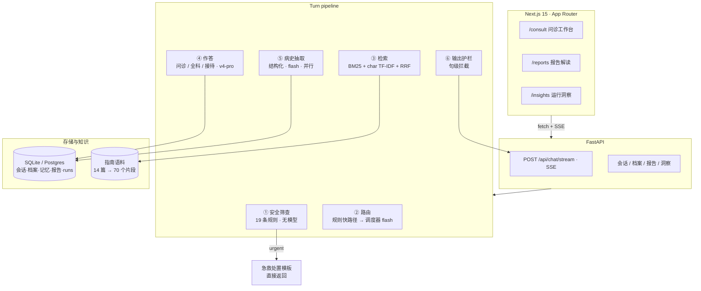
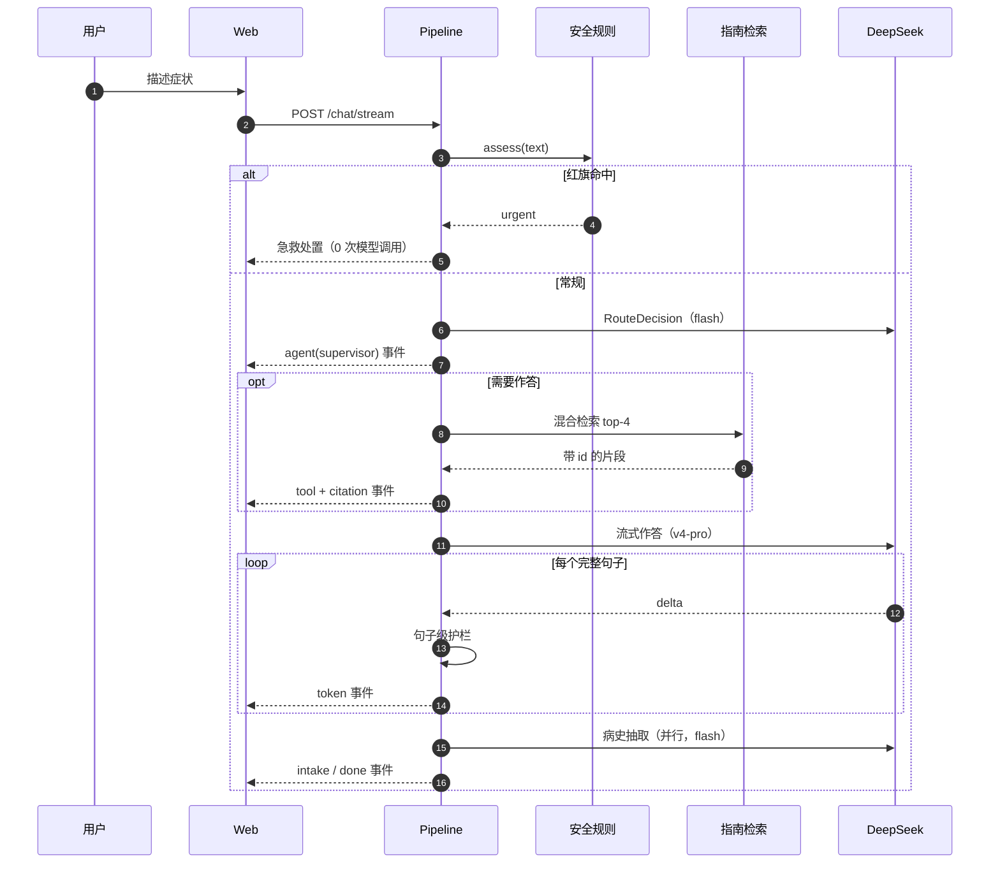

# Super-Doctor · 智能问诊多智能体系统

> 把「我不舒服」拆成结构化病史，先分诊、再给有出处的建议，并在需要急诊时不浪费一秒钟。

<p align="center">
  
</p>


<p align="center">
  
</p>
<p align="center">
  <a href="https://github.com/drunksu/super-doctor"></a>
  <a href="#快速开始"></a>
  
  
  
  
</p>

---

## 这是什么

一个可以直接跑起来的**智能问诊系统**：用户用自然语言描述不适，系统先做确定性的红旗症状筛查，再由调度器决定这一步该追问还是该作答，作答前先检索本地指南库，输出时逐句过安全护栏。

它不是一个"给大模型套一个医生人设"的聊天框。四个关键决定让它成为一套系统：

| 决定 | 做法 |
| --- | --- |
| **安全是闸门，不是提示词** | 19 条确定性规则先跑，命中红旗直接进急救处置模板，**不调用模型** |
| **检索在生成之前** | 医疗结论只能引用本轮实际检索到的片段，伪造的引用编号会被剥掉 |
| **结构化与流式分离** | 给人看的文字流式输出；给系统用的状态（槽位、分级、引用）走独立的类型化调用 |
| **句级输出护栏** | 处方式、确诊式句子在**到达前端之前**被替换，而不是事后补救 |

### 为什么叫 Super-Doctor

命名致敬 DeepSeek Harness 团队 2026 年 10 月 31 日提出的 [Super-agent](https://github.com/deepseek-ai/dsh-superagent-prototype)：一个常驻的 Router 承接人类交互、多个隔离的 Worker 并发干活、危险的事件不排队。这套思路放在医疗场景里，最该被"直通"的不是效率，而是**急诊**——所以 Super-Doctor 把红旗症状做成了完全绕开模型的快速路径。

| Super-agent 的四条特征 | 在 Super-Doctor 里的落点 |
| --- | --- |
| **连续**：跨渠道是同一个 Agent | 一个会话贯穿追问、建议、复查；结构化槽位与长期档案跨轮累积 |
| **高效**：并行、不阻塞 | 病史抽取与回答生成并行；流式逐句下发，不等整段 |
| **主动**：观察环境、该说话才说 | 不等用户点按钮：红旗命中直接给急救处置；无信息量时保持安静 |
| **持久**：异常可恢复 | 检索失败降级并标记 `ungrounded_answer`；调度超时走完整性兜底；解析失败给可操作提示 |

> 与参考实现的差异也写在明面上：Super-agent 原型是面向 GitHub/飞书的 coding agent，本项目是面向患者的问诊系统，因此复用了 **Router 收口 + Worker 隔离 + 事件分级** 的结构，而不是它的渠道与授权模型。

<p align="center">
  
</p>

---

## 三个场景

**1. 症状模糊时，先问对问题**
「最近总是头晕，早上起来尤其明显」→ 不问十个问题，只问最关键的那一个：「是几秒钟就过去，还是会持续一阵？」同时把主诉、起病、伴随症状写进结构化槽位。

**2. 需要建议时，给有出处的建议**
信息够了 → 检索指南 → 分方向作答（可能的方向 / 现在可以做 / 什么情况必须就医），每条结论后面挂着引用编号，点开就能看到原文段落。

**3. 该报警时，一秒钟都不浪费**
「我爸胸口压着疼，满头大汗」→ 规则命中 ACS 组合 → 立刻给出「拨打 120 + 停止活动 + 不要自行驾车」，**不经过模型**（评测里中位延迟 0 ms，单智能体基线 4.3 s）。

<p align="center">
  
</p>

---

## 架构



一次问诊的时序：



### 智能体分工

| 角色 | 模型 | 职责 | 输出契约 |
| --- | --- | --- | --- |
| 安全审查 | 无（规则） | 红旗症状、急诊分流 | `SafetyAssessment` |
| 调度器 | `deepseek-flash` | 追问 / 作答 / 寒暄 的路由 | `RouteDecision` |
| 结构化问诊 | `deepseek-v4-pro` | 一次只问一个关键问题 | 流式文本 |
| 全科顾问 | `deepseek-v4-pro` | 分方向建议 + 引用 + 就医指征 | 流式文本 |
| 病史抽取 | `deepseek-flash` | 把口述变成结构化槽位 | `IntakeExtraction` |
| 报告解读 | `deepseek-v4-pro` | 化验指标解释 + 问医生的问题 | `ReportNarrative` |

> 为什么快慢模型混用：路由只要判断"该谁说话"，`flash` 足够且便宜；写给人看的医学解释需要 `v4-pro`。这条分界线把每次问诊的成本压到原来的约 1/3。

---

## 评测

两个轨道，因为要回答的是两个不同的问题。完整方法见 [docs/evaluation.md](docs/evaluation.md)。

**A · 答案质量**：18 个「应当直接作答」的案例，两套系统拿到**同一批检索片段**、同一模型、同样要求，一次性作答；由 `deepseek-flash` 按案例 rubric 盲评（0–5）。

| 指标 | 多智能体（Super-Doctor） | 单智能体基线 |
| --- | --- | --- |
| LLM-as-judge 均分 | 4.06 | 4.44 |
| LLM-as-judge 通过率（≥4） | 0.83 | 0.94 |
| 有效引用率（引用编号确实来自本轮检索） | 1.00 | 1.00 |
| 禁用表达命中数 | 0 | 0 |
| 平均延迟 | 5.86 s | 4.31 s |
| 平均输出 token | 222 | 144 |

**B · 系统行为**（单智能体没有对应机制）：

| 指标 | 结果 |
| --- | --- |
| 急诊分流准确率（6 例急症） | **100%** |
| 急症首次回答延迟中位数 | **0 ms**（模板，无模型调用） |
| 首轮追问率（8 例信息不足） | **100%** |
| 单问题合规率 | 75% |
| 首轮问诊槽位填充率 | 32% |
| 可作答问题直接给建议的比例 | **100%** |

**怎么读这张表**：在"一次性把话说全"这件事上，单智能体略好——均分高 0.38，它不受结构化提示约束，写得更短、更直接。同一套代码连续三次评测的 judge 均分是 4.06 / 4.11 / 4.22（基线稳定在 4.44），真实差距大约 0.2–0.4，不值得当成"谁更强"。Super-Doctor 换到的是别的东西：急诊路径 0 延迟且不经过模型、100% 首轮追问、引用编号可校验、输出护栏。这个取舍在 [docs/architecture.md](docs/architecture.md) 里展开讲。延迟在两轮之间从 3.9 s 变到 5.9 s，主要是模型 API 的时段差异，不是架构变化。

> 样本量 32 例、单次运行、rubric 由本人生成，只能说明系统行为，不构成医学有效性证据。

---

## 技术栈

| 层 | 选择 | 为什么 |
| --- | --- | --- |
| 编排 | **PydanticAI 2.x** + 自研流水线 | 类型化输出、依赖注入、`TestModel` 级别的可测性；流水线是我自己写的显式状态机，流式语义完全可控 |
| 模型 | DeepSeek `v4-pro` / `flash` | 原生思维链、工具调用、OpenAI 兼容 |
| 检索 | BM25 + 字符 n-gram TF-IDF + RRF | 70 个中文片段上，字符空间模型对「低密度脂蛋白」这类术语比小稠密模型更稳，且零下载、零 GPU |
| 后端 | FastAPI + SQLAlchemy 2.0 async + SQLite/Postgres | 一条命令起；换 Postgres 只改 `DATABASE_URL` |
| 流式 | SSE（`sse-starlette`） | 比 WebSocket 简单，天然支持断线重连与代理 |
| 前端 | Next.js 15 + React 19 + Tailwind v4 | App Router、原生流式、零 UI 库 |
| 认证 | JWT（HS256）+ bcrypt | 无状态、易演示 |
| 测试 | pytest + httpx ASGITransport | 62 个用例，覆盖规则、检索、护栏、SSE 协议、报告解析 |

---

## 快速开始

**需要**：Python 3.12、Node 22、pnpm 9+。（没有 Docker 也能跑。）

```bash
# 1. 后端
python -m venv .venv
.venv/Scripts/pip install -e "backend[dev]"        # Windows
# .venv/bin/pip install -e "backend[dev]"          # macOS / Linux
cp backend/.env.example backend/.env               # 填入 DEEPSEEK_API_KEY
.venv/Scripts/python -m uvicorn app.main:app --port 8000 --app-dir backend

# 2. 前端
cd frontend && pnpm install && pnpm dev
```

打开 <http://localhost:3000>，用 `demo@superdoctor.ai` / `demo1234` 登录。

一键启动（Windows / macOS）：`pwsh -File scripts/dev.ps1` 或 `./scripts/dev.sh`。

**没有 API Key 也能跑**：不填 `DEEPSEEK_API_KEY` 时 `MODEL_MODE=auto` 会自动进入离线演示模式（脚本化对话、同样的 SSE 协议），`/api/health` 会如实返回 `model_mode: mock`。

Docker：

```bash
cp backend/.env.example .env         # 可选，不填则跑离线演示
docker compose up --build            # web :3000 · api :8000
```

---

## 安全边界

产品的边界写在三个地方，而不只是免责声明里：

1. **前置闸门**（`app/safety/rules.py`）：19 条规则、否定词窗口、只能升不能降。命中 `urgent` 时本轮不产生任何模型调用。
2. **检索约束**（`app/agents/pipeline.py`）：医学结论必须来自本轮检索片段；引用编号越界会被删除；一条都没检索到时，回答会带上 `ungrounded_answer` 标记。
3. **句级护栏**（`app/agents/guard.py`）：命中「药名 + 剂量」「确诊式表达」「剂量调整」的句子，在发送前替换为安全表述——不是事后过滤，因为事后过滤时字已经在用户屏幕上了。

62 个回归用例里，专门有一组是"模型试图越界"的对抗文本。

---

## 工程细节

**流式协议**：8 种事件（`run_started` / `agent` / `token` / `tool` / `citation` / `intake` / `safety` / `done`），前端只需要一个解析器，见 [docs/api-contract.md](docs/api-contract.md)。

**三层记忆**：消息窗口（session，TTL 30 天）→ 滚动摘要（每 6 条消息重生成）→ 结构化档案 + 语义记忆（user 级，永久）。结构化档案永远不被摘要——过敏史不能被压缩。

**降级策略**：调度器超时 → 按信息完整度兜底；检索为空 → 带标记作答；病史抽取失败 → 本轮照常结束；PDF 解析失败 → 给出可操作提示而不是 500。

**可观测性**：每个回答落一条 `runs` 记录（路由、安全等级、延迟、token、引用数），`/insights` 直接聚合这些数据，不另建一套埋点。

---

## 目录结构

```
backend/
  app/
    agents/       流水线、提示词、护栏、模型工厂、离线演示
    safety/       红旗症状规则
    rag/          语料加载、混合检索、引用
    memory/       短期窗口、摘要、长期档案与语义记忆
    api/          路由与 SSE
    evals/        评测集与双轨评测脚本
    services/     会话编排、报告解析、认证
  tests/          62 个用例
frontend/
  app/            /consult /reports /insights /login
  components/     23 个组件（时间线、引用卡、护栏横幅、指标表…）
docs/             架构、评测方法、API 契约、演示脚本
tools/            截图 / GIF 采集脚本
```

---

## 已知限制

- **不做诊断、不开处方**，也不解释医学影像（需要单独的 OCR/影像模型，本项目选择如实说不支持）。
- **评测样本 32 例**，rubric 自建，只能衡量系统行为，不能证明医学有效性。
- **单租户**：`user_id` 隔离足够演示，真实部署需要行级安全与字段级加密。
- **检索是稀疏模型**：语料扩到几百篇以上时应换成真正的 embedding 服务，接口已预留 `EmbeddingProvider`。
- Docker Compose 在本机没有 Docker 环境，未做过端到端验证（本地直跑路径是验证过的）。

---

## 面试时可以讲的三个点

1. **为什么把安全做成闸门而不是提示词**：提示词是不可验证的约束；规则可审计、可测试、零延迟，而且能在任何模型进入之前把急症拦下来。代价是规则会漏——所以语义层只能升级严重度，不能降级。
2. **为什么检索放在生成之前**：让"模型是否检索"从概率事件变成确定事实。副作用是引用可以校验、延迟可预测、失败可观测（`ungrounded_answer`）。
3. **为什么护栏是句级的**：流式场景里事后过滤没有意义——用户已经看到了。代价是首字延迟多一个句子（约 0.3–0.8 s），这个代价值得。

---

## 文档

- [架构与取舍](docs/architecture.md)
- [评测方法与复现](docs/evaluation.md)
- [API 契约](docs/api-contract.md)
- [演示脚本（GIF 分镜）](docs/demo.md)
- [English README](README.en.md)

---

MIT License · 本项目仅用于技术演示，提供健康信息与就医建议，不构成诊断或处方。紧急情况请立即拨打 120。
