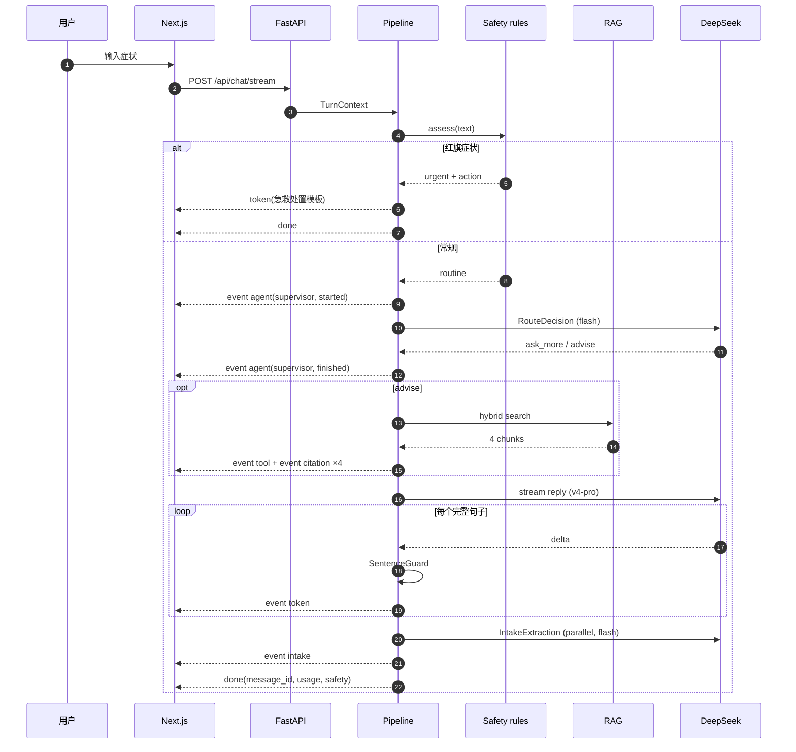
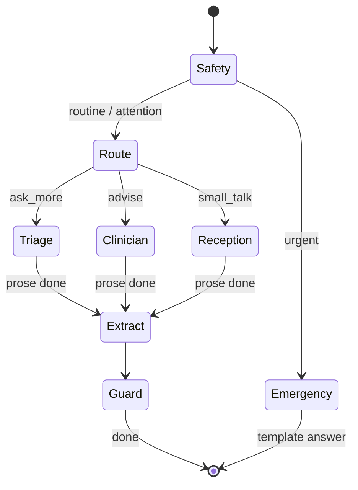
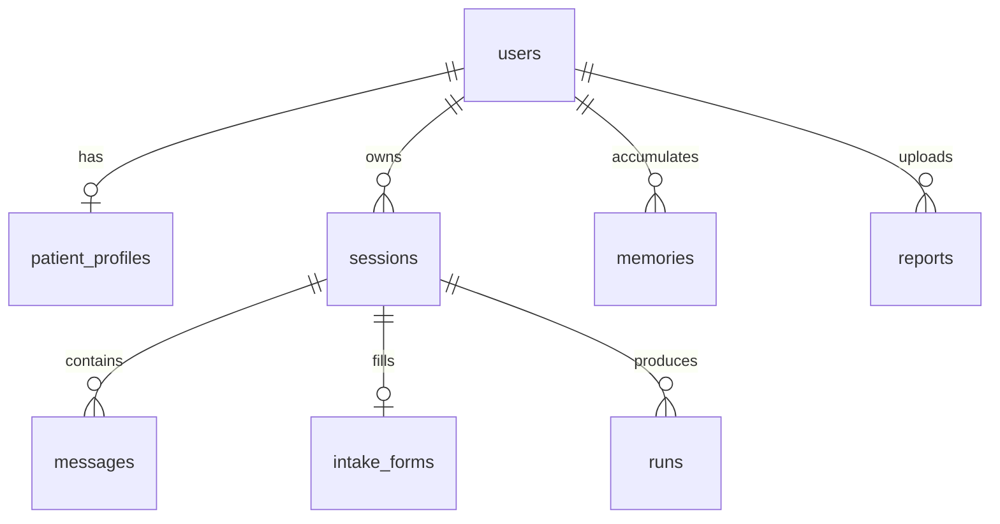

# Architecture

Super-Doctor is a triage-first medical consultation system. It is not a chatbot with a medical
prompt: the safety screen runs before any model call, retrieval runs before generation, and
the text that reaches the user has passed a sentence-level guard.

```
┌──────────────────────────────────────────────────────────────────────────────┐
│  Next.js 15 (App Router, SSE consumer)                                       │
│  /consult  ·  /reports  ·  /insights                                          │
└───────────────────────────────────┬──────────────────────────────────────────┘
                                    │  POST /api/chat/stream  (text/event-stream)
┌───────────────────────────────────▼──────────────────────────────────────────┐
│  FastAPI                                                                      │
│  ├─ auth (JWT)          ├─ sessions      ├─ reports (PDF / pasted values)    │
│  └─ insights (aggregates runs)                                               │
└───────────────────────────────────┬──────────────────────────────────────────┘
                                    │
┌───────────────────────────────────▼──────────────────────────────────────────┐
│  Turn pipeline (app/agents/pipeline.py)                                      │
│                                                                              │
│   1 safety screen  ── rules, deterministic, no model ──► urgent?  ──► playbook│
│   2 route          ── fast path rules → supervisor (deepseek-flash)          │
│   3 retrieve       ── BM25 + char TF-IDF + RRF over 70 guideline chunks      │
│   4 reply          ── triage │ clinician │ reception  (deepseek-v4-pro)      │
│   5 intake extract ── runs in parallel, structured slots                     │
│   6 output guard   ── sentence-level: no prescription, no diagnosis          │
└───────┬──────────────────────────┬──────────────────────────┬────────────────┘
        │                          │                          │
┌───────▼────────┐        ┌────────▼─────────┐       ┌────────▼────────┐
│  Memory        │        │  RAG             │       │  Observability  │
│  short-term    │        │  14 docs → 70    │       │  runs table     │
│  (messages +   │        │  sections, hybrid│       │  latency/tokens │
│   summary)     │        │  retrieval,      │       │  /insights      │
│  long-term     │        │  citation ids    │       │  eval harness   │
│  (profile +    │        └──────────────────┘       └─────────────────┘
│   memories)    │
└───────┬────────┘
        │
┌───────▼──────────────────────────────────────────────────────────────────────┐
│  SQLite (dev) / Postgres (prod) · SQLAlchemy 2.0 async                       │
│  users · sessions · messages · intake_forms · patient_profiles · memories     │
│  reports · runs                                                              │
└──────────────────────────────────────────────────────────────────────────────┘
```

## Why this shape

### 1. Safety is a gate, not a prompt

Every turn starts with `app/safety/rules.py`: 19 regex rules over the patient's own words,
with a negation window ("没有胸痛" must not fire). It costs microseconds and cannot
hallucinate. If it fires `urgent`, the turn ends in a fixed emergency playbook — no model
is called at all. That is the difference between "we tell the model to be careful" and
"a model is never in the loop for a possible heart attack".

The semantic layer can only *raise* severity (`merge()`); nothing can lower it.

### 2. Retrieval before generation

The clinician agent does not have a search tool. The pipeline retrieves with
`query = 用户原话 + 已知槽位`, injects the chunks, and validates every `[id]` marker against
what was actually retrieved. Consequences:

- **Grounding is observable**: you can log exactly which chunks each answer saw.
- **Citations cannot be hallucinated** — unknown ids are stripped before the text is stored.
- **Latency is predictable**: no "decide → call tool → wait → call model again" chain.
- **Failure is visible**: no hits → the response carries an `ungrounded_answer` safety flag
  instead of pretending to be sourced.

Trade-off: the model cannot ask for a second, more specific search. Accepted, because the
corpus is small (70 chunks) and k=4 with RRF already covers the recall we measured (see
`docs/evaluation.md`).

### 3. Structured side-effects, streamed prose

Two different things are happening in a turn: what the user reads (prose, must stream) and
what the system records (slots, safety, citations — must be typed). They are separated:

- prose → `agent.run_stream_events` → sentence guard → SSE `token` events
- state → separate structured calls (`RouteDecision`, `IntakeExtraction`, `ReportNarrative`)

An earlier version used tool calls for slot filling. It failed in a specific, instructive
way: the model narrated its tool plan into the visible answer
("可登记信息：- chief_complaint：头晕…"). Moving extraction to its own structured call
removed the failure mode and cut triage latency to ~2 s.

### 4. Memory has three layers, not two

| layer | scope | storage | lifetime | injected |
| --- | --- | --- | --- | --- |
| message window | session | `messages` | TTL 30 days | last 12 turns |
| rolling summary | session | `sessions.summary` | with session | always |
| structured profile | user | `patient_profiles` | permanent | always |
| semantic memory | user | `memories` | permanent, decayed by use | top-4 by similarity |

The structured profile exists because an allergy must never be summarised away. The
semantic layer exists because "去年做过胆囊手术" is worth remembering but does not belong in
a fixed schema.

### 5. The guard is sentence-level, not post-hoc

`SentenceGuard` buffers streamed text and releases it at `。！？；\n`. A prescriptive sentence
(`服用 … 400 毫克`) or a definitive diagnosis (`你得了 …`) is replaced before it is sent.
A post-hoc filter cannot do this: the tokens would already be on the user's screen.

Cost: first token appears one sentence later (~0.3–0.8 s). Worth it.

### 6. Latency is a product decision, measured not guessed

Measured on one machine, single requests, `deepseek-v4-pro`:

| configuration | TTFT | total | notes |
| --- | --- | --- | --- |
| thinking high (default) | 4.65 s | 5.20 s | good prose, slow start |
| thinking low (`reasoning_effort`) | 2.60 s | 3.29 s | — |
| thinking off, max_tokens 900 | 0.59 s | 1.67 s | used for triage |
| thinking off + 2.5k tokens runaway | — | **38 s** | the case that forced a token cap |

Current settings: triage `thinking=False, max_tokens=320`; clinician `thinking=False,
max_tokens=520` plus a hard 180–260 字 instruction. A full advise turn lands at 5–8 s
wall-clock, an emergency turn at ~1.2 s (template, no model).

## Turn sequence



## State machine



## Data model



## Failure behaviour

| failure | behaviour |
| --- | --- |
| supervisor times out | falls back to a completeness heuristic, `route.source = "fallback"` |
| clinician errors mid-stream | partial text is kept, the turn still ends with `done` |
| retrieval returns nothing | answer is sent with an `ungrounded_answer` attention flag |
| intake extraction fails | turn completes; slots simply do not advance |
| report PDF unreadable | 202 + `failed` insight with an actionable message, not a crash |
| model key missing | `model_mode: mock`, scripted pipeline, same SSE contract |

## Deliberate non-goals

- **No diagnosis, no prescription.** Enforced in prompt, in the guard, and in the eval set.
- **No medical image interpretation.** OCR would need a separate model; the product says so
  instead of guessing at pixels.
- **No multi-tenant isolation beyond `user_id`.** Single-tenant demo; a real deployment
  needs row-level security in Postgres and per-tenant encryption keys.
- **No claim of clinical validation.** The eval set is 32 synthetic cases; that measures
  behaviour, not medicine.
